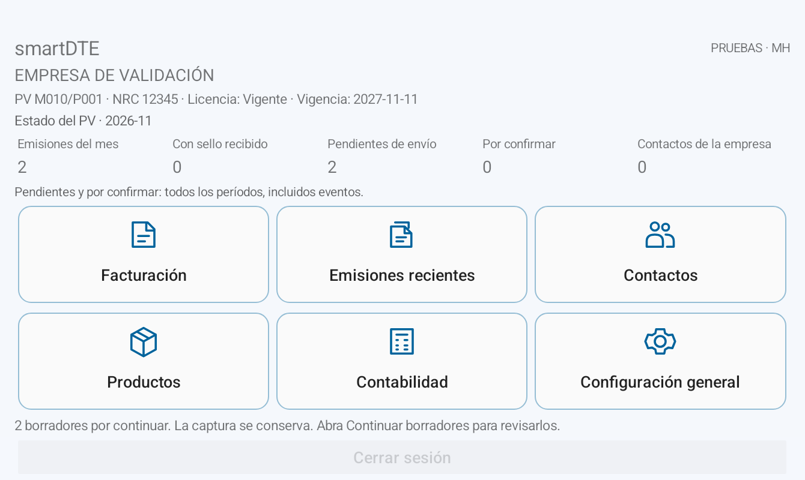
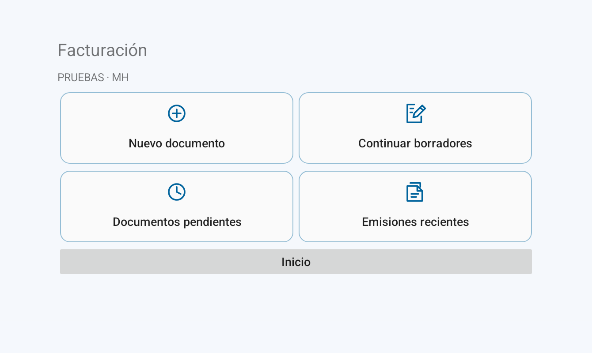
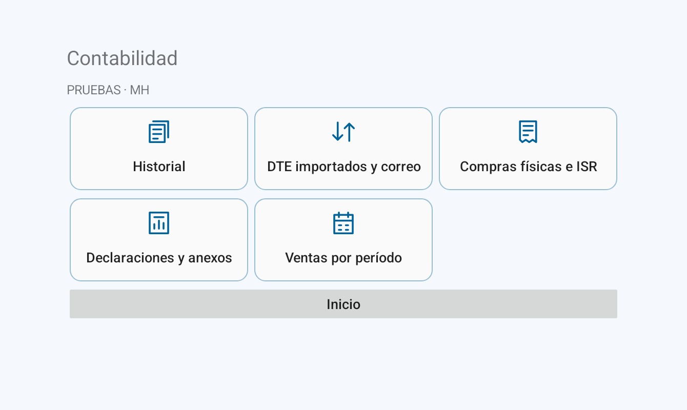
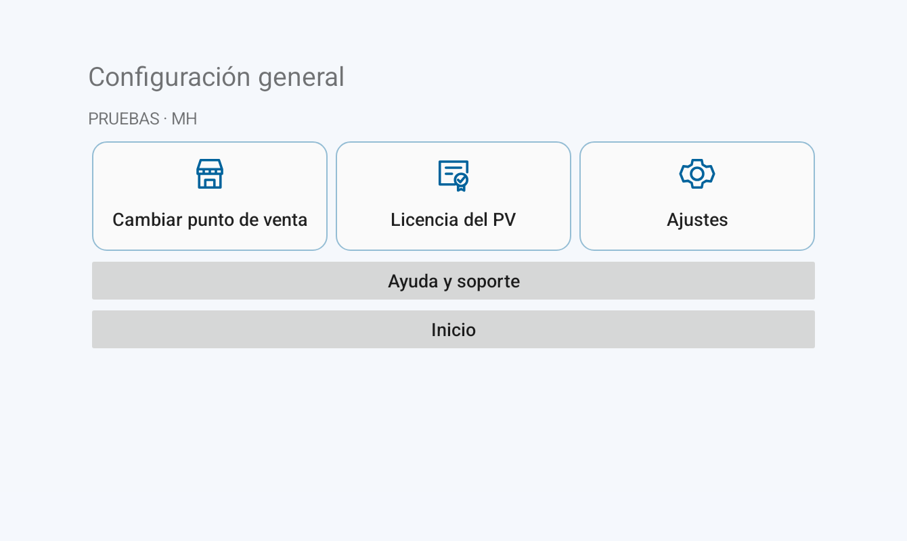
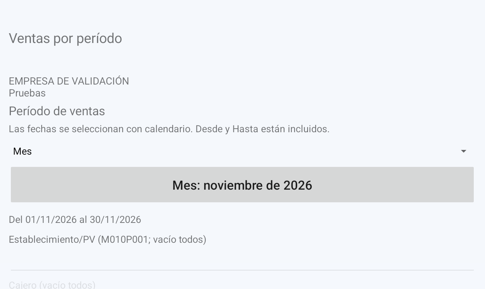

# smartDTE para Android

Facturación electrónica de El Salvador desde teléfonos y tablets, con firma local y conexión con el Ministerio de Hacienda. Permite preparar, emitir, consultar y entregar documentos sin depender de una PC.

**Versión 1.3.0**

[**Descargar el instalador APK**](https://github.com/miliky/smartDTE_android/raw/refs/heads/main/smartDTE-1.3.0.apk) · [**Manual ilustrado en PDF**](Manual-smartDTE-Android.pdf)

## Funciones

- Facturación con borradores, receptor, productos, pagos, descuentos, retenciones y observaciones.
- Firma en Android, transmisión al ambiente de MH seleccionado y conservación de respuestas y sellos.
- Emisiones recientes para abrir, compartir o preparar la impresión de PDF y JSON.
- Crear otro DTE del mismo tipo desde una factura, crédito fiscal, sujeto excluido o exportación admitidos.
- Contactos, productos, inventario e importación/exportación de catálogos.
- Historial e importación de documentos, adjuntos de correo, compras físicas e ISR.
- Declaraciones, libros, anexos y ventas por día, mes o rango mediante calendarios.
- Empresas y puntos de venta, permisos, licencia por NRC, respaldo cifrado y ayuda sin conexión.

## Requisitos

- Android **8.0 o posterior**, de **64 bits ARM64 o x86_64**, y espacio para documentos y respaldos.
- Datos del contribuyente y del punto de venta.
- Licencia SmartDTE del NRC y permisos de usuario para las funciones correspondientes.
- Para firmar y transmitir: certificado y credenciales de firma/API de MH del contribuyente y ambiente.
- Internet para consultar licencias, transmitir a MH o descargar correo. El modo local conserva los datos en el dispositivo; el origen compartido es opcional.

## Instalar y configurar

1. Descargue el APK completo mediante el enlace de esta página.
2. Ábralo desde Descargas y autorice la instalación desde ese navegador o gestor de archivos si Android lo solicita.
3. Cree el administrador local y configure empresa, ambiente, establecimiento y punto de venta.
4. Revise la licencia del NRC en **Configuración general → Licencia del PV**.
5. Configure certificado y credenciales en **Configuración general → Ajustes → Firma y API de MH**.
6. Compruebe primero su configuración en el ambiente **00 · Pruebas**. Confirme el estado y el sello de los documentos enviados.

El [manual ilustrado](Manual-smartDTE-Android.pdf) explica instalación, configuración y uso. Una actualización oficial con la misma firma se instala sobre la app existente. Conserve sus respaldos; si Android informa un conflicto de firma o paquete, solicite soporte antes de desinstalar.

## Nuevas vistas

El inicio informa empresa, PV, ambiente, licencia y estado. Las tarjetas agrupan las tareas; **Inicio**, **Ayuda** y **Cerrar sesión** conservan los botones correspondientes.

| Facturación | Contabilidad |
| --- | --- |
|  |  |

| Configuración general | Ventas por período |
| --- | --- |
|  |  |

[Ver Contactos](assets/contactos-portrait.png) · [Ver Productos](assets/productos-portrait.png) · [Ver emisiones recientes](assets/emisiones-recientes.png)

Todas las imágenes de esta entrega se obtuvieron de la app real con datos ficticios. Cancelar una revisión de importación conserva la ficha y sus cambios sin guardar, también al recrear la pantalla.

## Documentos e impresión

Guardar, compartir o imprimir conserva el estado del documento. La recepción fiscal se comprueba con la respuesta y el sello de MH. La impresión utiliza el servicio Android compatible con su impresora; la salida en impresora física requiere su propia prueba.

## Soporte y licencias

- Sitio: [smart.dte.company](https://smart.dte.company/).
- Oficina y tutoriales: **+503 7858 6614**, **smart-dte@outlook.com**, lunes a sábado de 8:00 a 16:00.
- Soporte extendido: **+503 7867 4352**, **jefm@outlook.com**, lunes a sábado de 8:00 a 22:00.
- Horarios de El Salvador; sin atención los domingos.

La licencia de uso SmartDTE se gestiona por NRC. Los avisos de los componentes incluidos están en [THIRD_PARTY_NOTICES.md](THIRD_PARTY_NOTICES.md) y la carpeta [licenses](licenses/).

Este repositorio ofrece el instalador, el manual y sus capturas. Conserve certificados, contraseñas, datos de negocio y respaldos en ubicaciones privadas.

## Referencias oficiales

- [Android: instalación desde un sitio web u otra fuente](https://developer.android.com/distribute/marketing-tools/alternative-distribution?hl=es).
- [Android: firma de aplicaciones y actualizaciones](https://developer.android.com/studio/publish/app-signing).
- [Microsoft: autorización mediante código de dispositivo](https://learn.microsoft.com/en-us/entra/identity-platform/v2-oauth2-device-code).
